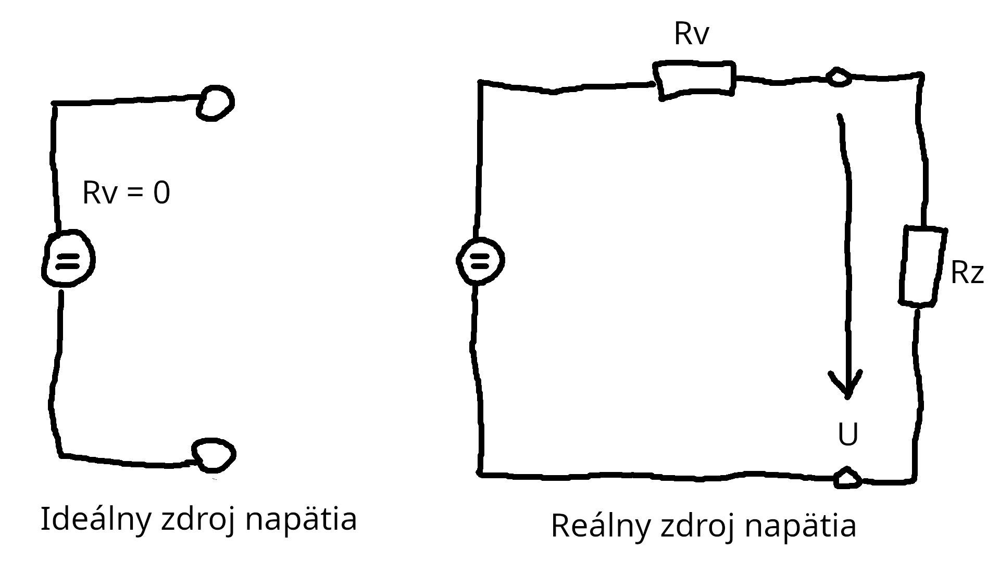
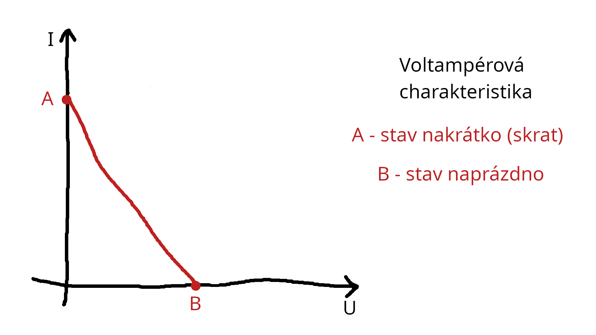

# Napájacie zdroje

- napájací zdroj je zariadenie ktoré trvalo dodáva do záťaže (spotrebiča) elektrickú energiu
- ideálny zdroj napätia má nejakú hodnotu vnútorného napätia $U_{v}$
- vnútorný odpor sa rovná $0$
- svorkové napätie je rovné vnútornému napätiu a nezávisí od prúdu na záťaži
- to znamená = keď mi má dať $12\,\mathrm{V}$, dá mi $12\,\mathrm{V}$ (nič sa nestratí)
- keď prechádza prúd cez súčiastky, ktoré sa nachádzajú v zdroji, dávajú do obvodu odpor
- tento odpor tvorí vnútorný odpor zdroja
- je to vnútorný odpor zdroja ($R_{v}$)
- pri zdroji napätia sa vnútorný odpor kreslí vždy sériovo so zdrojom

- $U$ je napätie na svorkách ktoré reálne nameriame
- napätie $U$ závisí od vnútorného odporu
- prúd vypočítame ako (z ohmovho zákona):

  $$
  I = \frac{U_{v}}{R_{v} + R_{z}}
  $$

  (zátvorky aby bolo jasné že je to zlomok)
- $U_{v}$ je napätie zdroja
- keď dosadíme do ohmovho zákona všetky dostupné veličiny čo tu máme, pre výpočet napätia na svorkách dostaneme:

  $$
  U = \frac{U_{v} \cdot R_{z}}{R_{v} + R_{z}}
  $$

  (zátvorky aby bol jasný zlomok)
- reálny napäťový zdroj môže byť lineárny -> jeho grafom je priamka
- nelineárny -> jeho grafom je krivka

