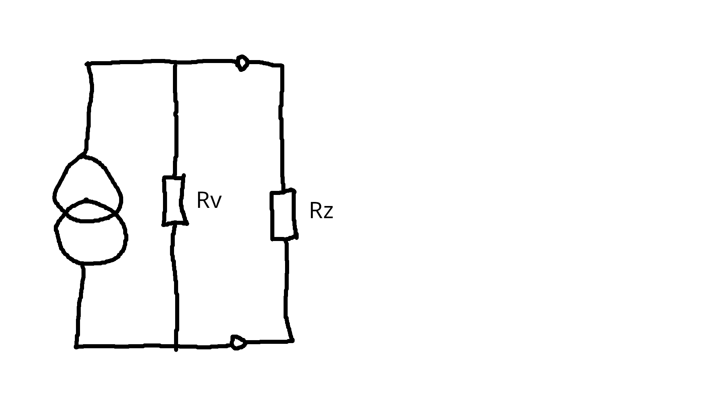

# Prúdový zdroj

ideálny:
- má nekonečne veľký vnútorný odpor
- prúd dodávaný do záťaže sa rovná prúdu ktorý dodáva zdroj

reálny:
- pri prúdovom zdroji sa jeho vnútorný odpor počíta tak, ako keby bol pripojený paralelne

- prúdový zdroj má veľký vnútorný odpor a drží takmer konštantný prúd aj pri veľkej zmene odporu záťaže (taký zdroj sa volá tvrdý zdroj)
