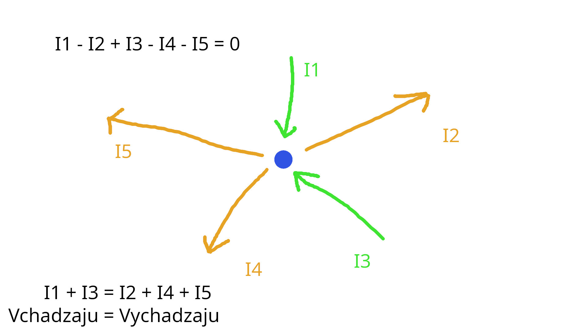
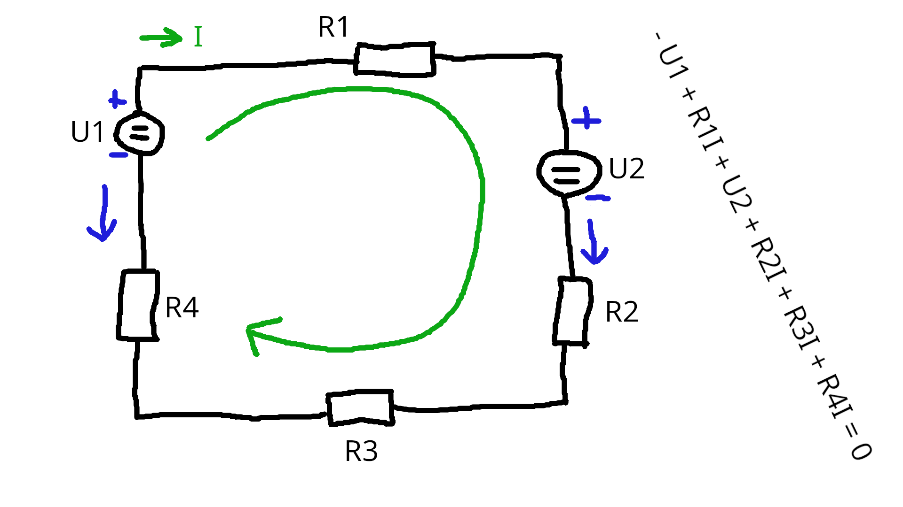

# Kirchhoffove zákony

1. KZ -> algebraický súčet prúdov v uzle sa rovná nule (koľko vtečie toľko vytečie)
  - prúdy ktoré vtekajú majú znamienko $+$ (plus), tie ktoré vytekajú majú znamienko $-$ (mínus)

2. KZ -> súčet napätí v uzavretej slučke sa rovná nule
  - využíva ohmov zákon ($U = R \cdot I$)
  - smer slučky si môžeme určiť my
  - v slučke sa musia brať do úvahy všetky napájacie zdroje
  - keď smer napätia zo zdroja ide oproti smeru slučky, odpočítavame (mínus)

