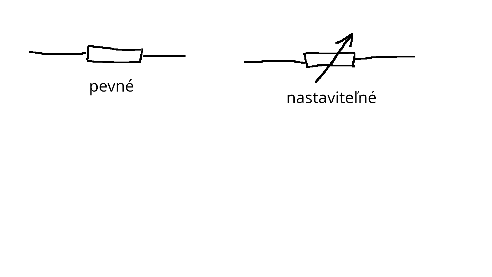

# Rezistory

- je dvojpólová pasívna súčiastka, ktorej základnou vlastnosťou je elektrický odpor
- rezistory poznáme:
    - pevné (nemenia svoju hodnotu)
    - nastaviteľné:
        - potenciometer
        - reostat
        - trimer

- potenciometer a reostat sú vyvedené na vonkajší panel zariadenia, majú bežec
- potenciometrom meníme napätie a tým sa mení odpor
- reostatom meníme odpor
- trimer je potenciometer zabudovaný do schémy
- hodnota odporu sa nastavuje skrutkovačom (alebo napr. mincou)
- hodnotu rezistorov môžeme zistiť:
  - $R = \rho \cdot \frac{l}{S}$
  - pomocou pásikov
  - ohmmetrom
- vlastnosti:
  1. menovitý odpor - hodnota rezistora
  2. menovité zaťaženie - výkon, ktorý sa môže premeniť na teplo
  3. prevádzkové zaťaženie - aké zaťaženie na neho môžme dať kým sa nezničí
  4. najväčšie dovolené napätie - najväčšie dovolené napätie na jeho svorkách
  5. teplotný súčiniteľ odporu
  6. šumové napätie
