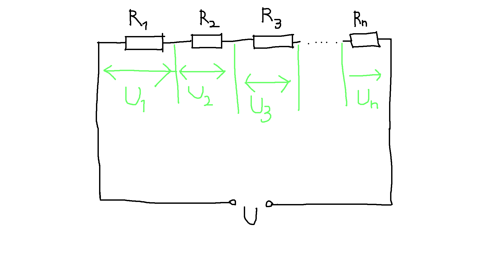
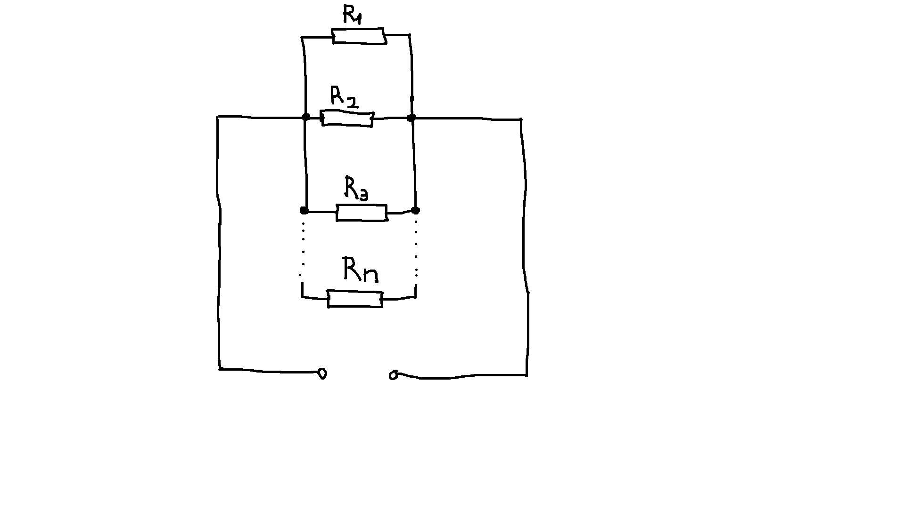

# Sériové zapojenie rezistorov

- v sériovo zapojenom obvode je prúd rovnaký a mení sa napätie
- keď prejde prúd cez hocijaký rezistor, vzniká na ňom napätie, ktoré sa nazýva úbytok napätia

- vyjadríme napätie z ohmovho zákona 

  $$
  \begin{aligned}
  U &= U_{1} + U_{2} + U_{3} + .... U_{n} \\
  IR &= IR_{1} + IR_{2} + IR_{3} + \ldots IR_{n} \\
  IR &= I(R_{1} + R_{2} + R_{3} + \ldots R_{n}) \\
  R &= R_{1} + R_{2} + R_{3} + \ldots R_{n}
  \end{aligned}
  $$

- pri sériovom zapojení rezistorov sa výsledný odpor rovná súčtu jednotlivých odporov
- v sériovom zapojení platí že výsledný odpor je vždy väčší ako najväčší z nich (je súčet)

# Paralelné zapojenie

- pri pararelnom zapojení súčiastok v akomkoľvek obvode sa mení prúd (sú tam uzly) a napätie ostáva rovnaké

- podľa ohmovho zákona:

  $$
  \begin{aligned}
  \frac{U}{R} &= \left(\frac{U}{R_{1}}\right) + \left(\frac{U}{R_{2}}\right) + \left(\frac{U}{R_{3}}\right) + \ldots + \left(\frac{U}{R_{n}}\right) \\
  U\left(\frac{1}{R}\right) &= U\left(\left(\frac{1}{R_{1}}\right) + \left(\frac{1}{R_{2}}\right) + \left(\frac{1}{R_{3}}\right) + \ldots + \left(\frac{1}{R_{n}}\right)\right) \\
  \frac{1}{R} &= \frac{1}{R_{1}} + \frac{1}{R_{2}} + \frac{1}{R_{3}} + \ldots + \frac{1}{R_{n}}
  \end{aligned}
  $$

- prevrátená hodnota výsledného odporu sa rovná súčtu prevrátených hodnôt jednotlivých odporov
- pre dva paralelne zapojené odpory platí:

  $$
  R = \frac{R_{1} \cdot R_{2}}{R_{1} + R_{2}}
  $$

- v paralelne zapojenom obvode je lepšie počítať s vodivosťou, kde:

  $$
  \frac{1}{R} = G \Rightarrow G = G_{1} + G_{2} + G_{3} + \ldots + G_{n}
  $$
