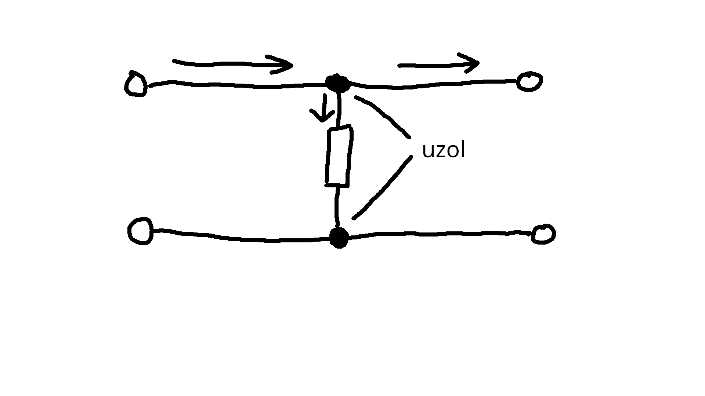
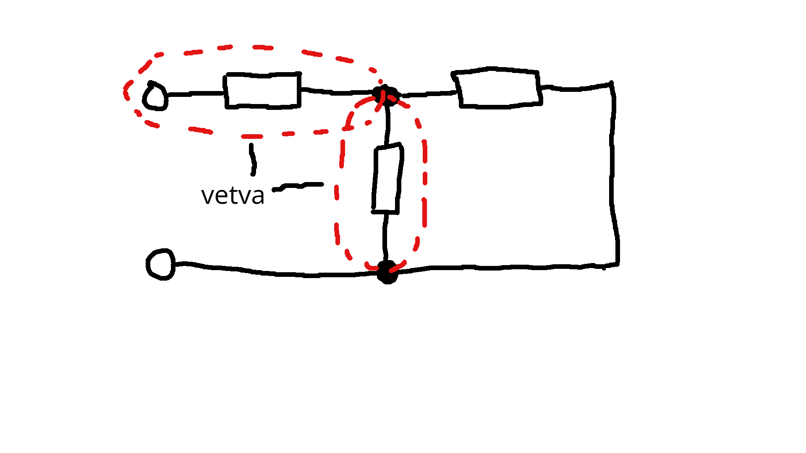
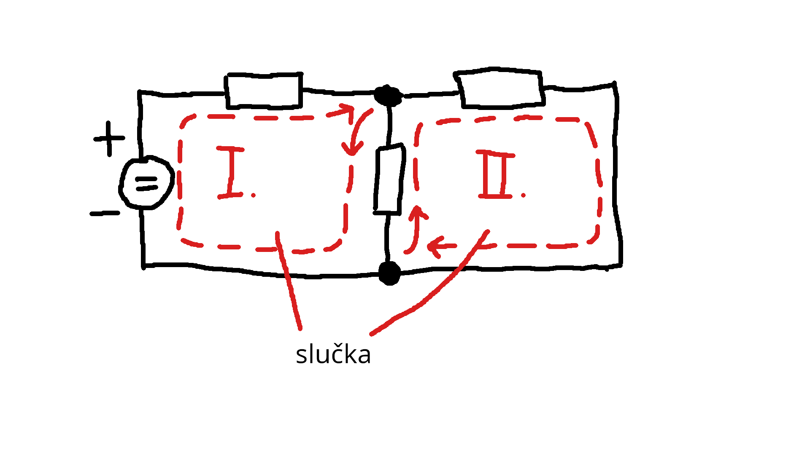
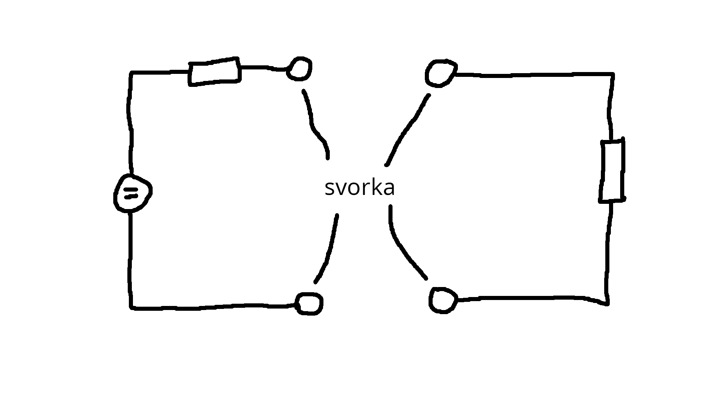

# Elektrický obvod

- je sústava elektrických zariadení, alebo súčiastok, ktoré sú navzájom elektricky spojené
- každý elektrický obvod musí mať zdroj a spotrebič, ktoré sú spojené káblamy (, drôtmi, vodivími cestami, ...)
- zariadenie sa skladá zo súčiastok
- súčiastka sa nedá rozdeliť, ináč by sme ju zničili
- v obvode sa nachádza:
  - **uzol** -> je vodivé spojenie najmenej troch drôtov, rozdeľujú sa v ňom prúdy (je križovatka pre prúdy), označuje sa plnou guličkou

    

  - **vetva** je časť obvodu medzi dvoma uzlami

    

  - **slučka** -> je uzavretý kruh pozostávajúci z najmenej dvoch vetiev a jedného uzla, smer slučky si vyberáme my

    

  - **svorka** -> vodivé ukončenie obvodu (alebo začiatok), označuje sa prázdnym krúžkom

    
