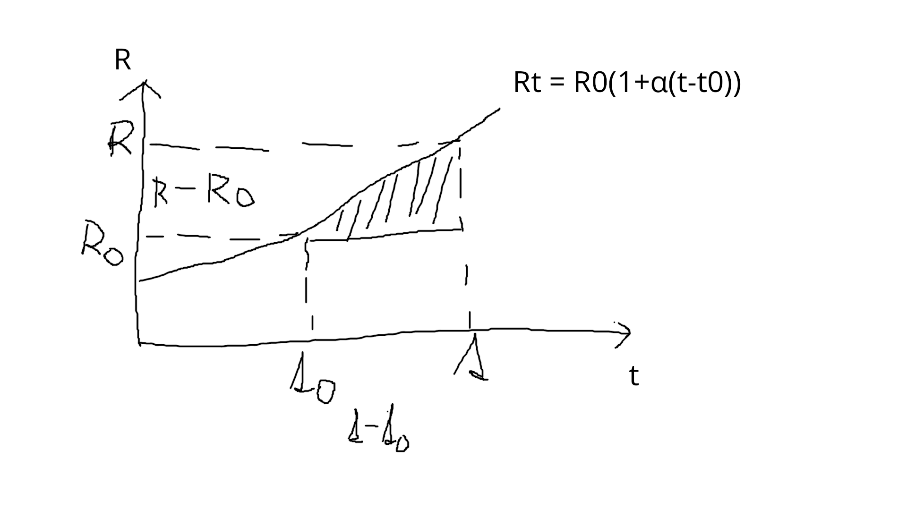

# Závislosť odporu od teploty

- na odpor materiálu má vplyv napríklad teplota, tlak, svetlo, poveternostné podmienky, atď.
- u kovou odpor s teplotou rastie, u nekovov klesá
- teplotný súčitinel "alfa" (grécke písmeno) vyjadruje zmenu odporu pri ohriatí o $1\,\mathrm{^{\circ}C}$ oproti pôvodnej hodnote, je to tabuľková hodnota
- $R_{0}$ a $t_{0}$ sú pôvodné hodnoty
- $R_{t} = R_{0}[1+\alpha(t-t_{0})]$

## Supravodivosť

- je jav pri ktorom materiály strácajú odpor a veľmi dobre vedú elektrický prúd
- tento jav nastáva cca. okolo $-273\,\mathrm{^{\circ}C}$ ($0\,\mathrm{K}$)
- ak sa teplota zvýši, prestane to fungovať
- typický materiál: Bór
