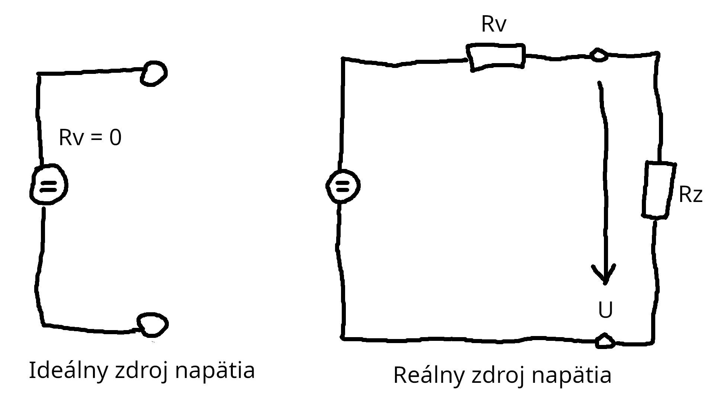
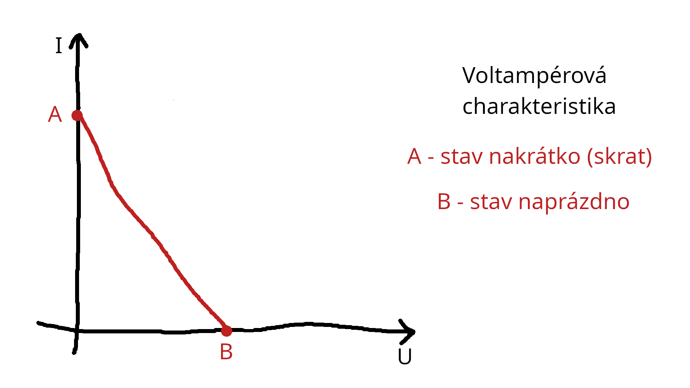
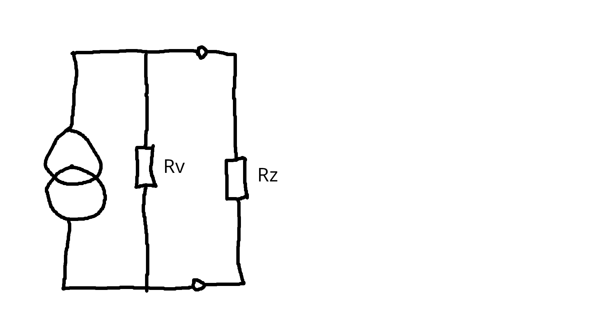

# Napájacie zdroje

Zdroje: [hodina 10](../hodiny/hodina10.md), [hodina 11](../hodiny/hodina11.md)

Napájací zdroj je zariadenie, ktoré trvalo dodáva do záťaže (spotrebiča) elektrickú energiu.

## Ideálny zdroj napätia

Ideálny zdroj napätia má nejakú hodnotu vnútorného napätia $U_{v}$.

Vnútorný odpor sa rovná $0$.

Svorkové napätie je rovné vnútornému napätiu a nezávisí od prúdu na záťaži.

To znamená, keď mi má dať $12\,\mathrm{V}$, dá mi $12\,\mathrm{V}$, nič sa nestratí.

## Vnútorný odpor a svorkové napätie

Keď prechádza prúd cez súčiastky, ktoré sa nachádzajú v zdroji, dávajú do obvodu odpor.

Tento odpor tvorí vnútorný odpor zdroja. Je to vnútorný odpor zdroja $R_{v}$.

Pri zdroji napätia sa vnútorný odpor kreslí vždy sériovo so zdrojom.

$U$ je napätie na svorkách, ktoré reálne nameriame.

Napätie $U$ závisí od vnútorného odporu.

Prúd vypočítame ako z ohmovho zákona:

$$
I = \frac{U_{v}}{R_{v} + R_{z}}
$$

Zátvorky, aby bolo jasné, že je to zlomok.

$U_{v}$ je napätie zdroja.

Keď dosadíme do ohmovho zákona všetky dostupné veličiny, čo tu máme, pre výpočet napätia na svorkách dostaneme:

$$
U = \frac{U_{v} \cdot R_{z}}{R_{v} + R_{z}}
$$

Zátvorky, aby bol jasný zlomok.

## Graf reálneho napäťového zdroja

Reálny napäťový zdroj môže byť lineárny, jeho grafom je priamka.

Nelineárny, jeho grafom je krivka.

## Prúdový zdroj

Zdroj: [hodina 11](../hodiny/hodina11.md)

### Ideálny prúdový zdroj

Má nekonečne veľký vnútorný odpor.

Prúd dodávaný do záťaže sa rovná prúdu, ktorý dodáva zdroj.

### Reálny prúdový zdroj

Pri prúdovom zdroji sa jeho vnútorný odpor počíta tak, ako keby bol pripojený paralelne.

Prúdový zdroj má veľký vnútorný odpor a drží takmer konštantný prúd aj pri veľkej zmene odporu záťaže. Taký zdroj sa volá tvrdý zdroj.
