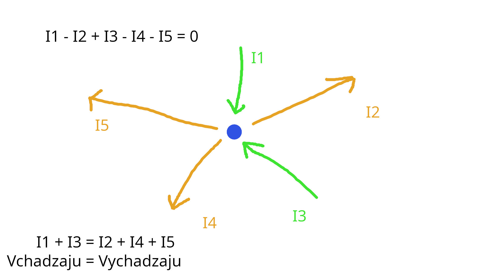
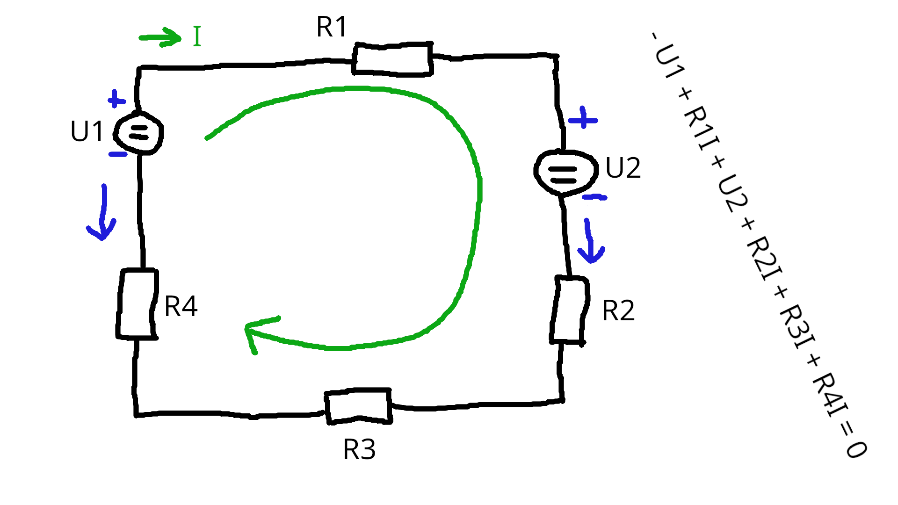

# Kirchhoffove zákony

Zdroj: [hodina 12](../hodiny/hodina12.md)

## Prvý Kirchhoffov zákon

Algebraický súčet prúdov v uzle sa rovná nule. Koľko vtečie, toľko vytečie.

Prúdy, ktoré vtekajú, majú znamienko $+$, plus. Tie, ktoré vytekajú, majú znamienko $-$, mínus.

## Druhý Kirchhoffov zákon

Súčet napätí v uzavretej slučke sa rovná nule.

Využíva ohmov zákon:

$$
U = R \cdot I
$$

Smer slučky si môžeme určiť my.

V slučke sa musia brať do úvahy všetky napájacie zdroje.

Keď smer napätia zo zdroja ide oproti smeru slučky, odpočítavame, mínus.

