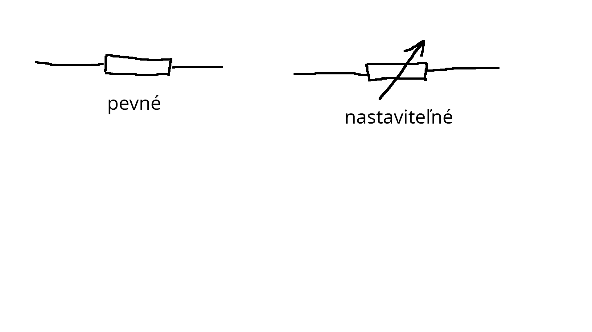

# Rezistory

Zdroj je [hodina 13](../hodiny/hodina13.md).

Rezistor je dvojpólová pasívna súčiastka, ktorej základnou vlastnosťou je elektrický odpor.

## Druhy rezistorov

- Pevné rezistory nemenia svoju hodnotu.
- Medzi nastaviteľné rezistory patria potenciometer, reostat a trimer.

Potenciometer a reostat sú vyvedené na vonkajší panel zariadenia a majú bežec.

- Potenciometrom meníme napätie a tým sa mení odpor.
- Reostatom meníme odpor.
- Trimer je potenciometer zabudovaný do schémy.

Hodnota odporu sa nastavuje skrutkovačom alebo napríklad mincou.

## Určenie hodnoty rezistora

- Výpočtom podľa vzorca $R = \rho \cdot \frac{l}{S}$, kde $\rho$ je merný odpor.
- Pomocou pásikov.
- Ohmmetrom.

## Vlastnosti rezistorov

1. Menovitý odpor je hodnota rezistora.
2. Menovité zaťaženie je výkon, ktorý sa môže premeniť na teplo.
3. Prevádzkové zaťaženie udáva, aké zaťaženie na rezistor môžme dať, kým sa nezničí.
4. Najväčšie dovolené napätie je najväčšie dovolené napätie na svorkách rezistora.
5. Teplotný súčiniteľ odporu.
6. Šumové napätie.
